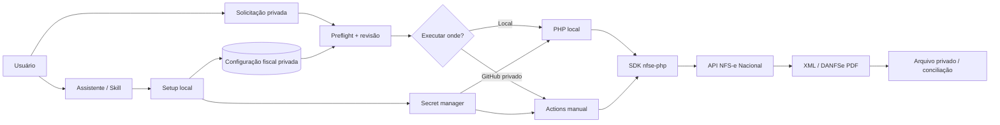
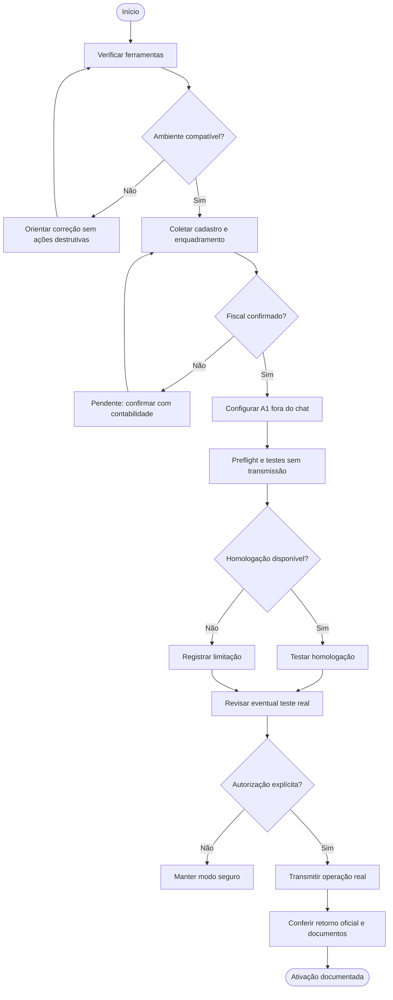
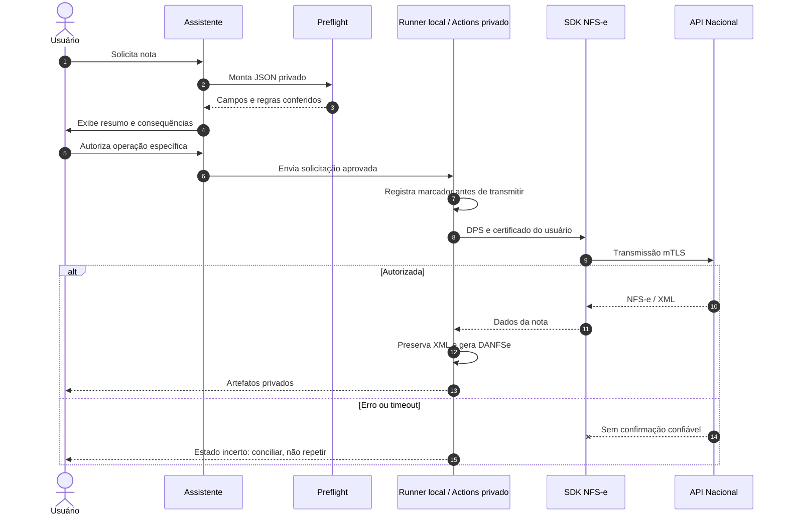
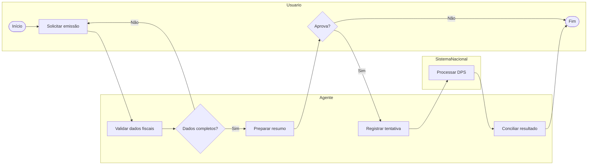
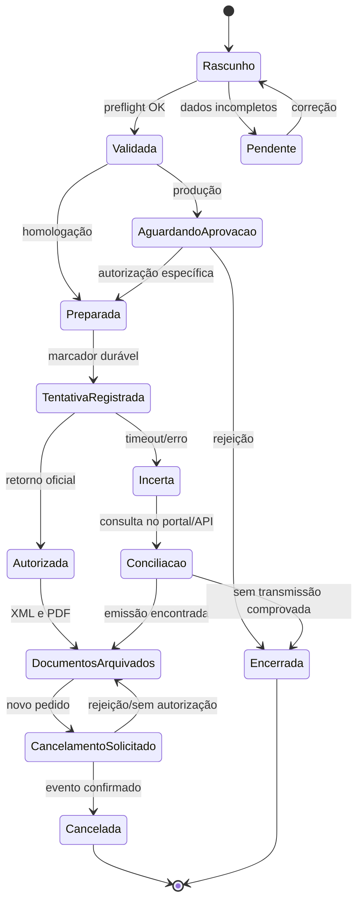

# NFS-e Nacional Automation

**Emissão e cancelamento de NFS-e Nacional com instalação guiada, execução local ou GitHub Actions e assistentes de IA.**

> **Boas-vindas!** Este projeto começa perguntando sobre sua realidade fiscal e operacional. Não existe CNPJ, certificado, cliente, descrição ou alíquota predefinida. A configuração é individual e **nunca deve ser enviada para o repositório de código**.

**Estado:** beta; testes locais/CI não equivalem a uma emissão autorizada. **Repositório de código deve permanecer privado até a revisão de segurança para abertura pública.** Para operar com GitHub Actions, cada usuário deve manter seu **próprio repositório de execução privado**: notas, certificado e dados fiscais não pertencem a repositórios públicos.

## Comece aqui

| Seu ambiente | Primeira ação | Guia |
|---|---|---|
| ChatGPT Work com acesso aos arquivos | Abra a pasta e peça "Instale meu emissor de NFS-e seguindo AGENTS.md" | [IA](docs/AI_SETUP_PROMPT.md) |
| Codex CLI/IDE | Abra a pasta e peça "Use a skill nfse-setup para fazer o onboarding" | [Skill](.agents/skills/nfse-setup/SKILL.md) |
| Claude Code | Abra a pasta e peça "Use nfse-setup; configure meu prestador e minha rotina" | [Skill](.claude/skills/nfse-setup/SKILL.md) |
| Terminal | `composer install && python3 scripts/setup.py` | [Instalação](docs/INSTALLATION.md) |

**Importante:** abrir um link em um chat não concede acesso automático ao terminal, ao GitHub ou aos Secrets. Para executar, use um agente com acesso autorizado à pasta/terminal. O assistente nunca deve solicitar que você cole PFX/P12, senha ou chave privada no chat.

### Instalação rápida

```bash
git clone https://github.com/brlgirardi/nfse-nacional-automation.git
cd nfse-nacional-automation
composer install
python3 scripts/setup.py
php scripts/preflight.php
```

A configuração privada é salva em `config/modelo-fiscal.json` (ignorado pelo Git). Para usar o GitHub Actions, faça uma cópia/fork **privado** para execução e configure seus próprios Secrets com `bash scripts/configure-github.sh`. Para execução local, use `bash scripts/run-local.sh requests/<arquivo>.json`. Leia os guias antes de transmitir.

## O que o assistente pergunta na primeira execução?

1. **Ambiente:** sistema operacional, PHP 8.4+, Composer, acesso ao GitHub, local ou Actions.
2. **Prestador:** cadastro, município, inscrição municipal e habilitação nacional.
3. **Fiscal:** regime tributário, Simples, apuração, códigos de serviço, NBS (quando aplicável), ISS e retenção, todos validados pela contabilidade.
4. **Certificado A1:** existência, validade e correspondência ao prestador; configuração direta em armazenamento seguro, **nunca no chat**.
5. **Rotina:** serviços prestados, tomadores recorrentes, descrição padrão, competência, periodicidade, aprovação, armazenamento e entrega.
6. **Validação:** dependências, preflight, homologação quando disponível e revisão humana antes de qualquer operação real.
7. **Ativação:** registrar o que foi comprovado e o que permanece pendente. Emissão e cancelamento são autorizações **separadas**.

A skill é **adaptativa**: identifica campos faltantes, pergunta somente o necessário, não inventa informações tributárias e reaproveita apenas preferências explicitamente confirmadas, guardadas fora do Git. Veja [o contrato de onboarding](docs/ONBOARDING.md).

## Visão da arquitetura



## Fluxo de instalação e habilitação



## Diagrama de sequência: emissão



## Processo BPMN simplificado (representação Mermaid)



> O gráfico acima descreve os papéis e decisões do processo, mas **não é um arquivo BPMN 2.0 executável**.

## Máquina de estados da operação



## Organização do repositório

```text
.
├── .agents/skills/nfse-setup/SKILL.md   # Skill Codex/agentes
├── .claude/skills/nfse-setup/SKILL.md   # Skill Claude Code
├── .github/workflows/                   # CI e operação manual
├── config/modelo-fiscal.example.json    # Exemplo SEM dados reais
├── docs/                                # Instalação, fluxos e segurança
├── examples/                            # Payloads fictícios
├── scripts/                             # Setup, preflight e execução
├── src/                                 # Emissão e cancelamento PHP
├── tests/                               # Testes offline
├── AGENTS.md                             # Instruções para agentes
└── CLAUDE.md                             # Instruções Claude
```

### Executar localmente ou no GitHub Actions

**Local:** `python3 scripts/new-request.py` → `php scripts/preflight.php requests/<arquivo>.json` → `bash scripts/run-local.sh requests/<arquivo>.json`. Certificado e senha ficam no cofre/ambiente local.

**Actions:** no **repositório de execução privado**, `bash scripts/configure-github.sh` → `python3 scripts/new-request.py` → `bash scripts/send-request.sh requests/<arquivo>.json`. O workflow é manual, confere hash e confirmação de produção, guarda marcador de tentativa e publica XML/PDF em artefatos **privados** com retenção limitada. Consulte [GitHub Actions](docs/GITHUB_ACTIONS.md).

**Nunca rode o fluxo fiscal em uma cópia pública com dados reais ou Secrets.** Código open source e operação fiscal privada são responsabilidades separadas.

## Segurança, limites e qualidade

- `config/modelo-fiscal.json`, `requests/`, `output/`, `.env` e certificados estão no `.gitignore`; revise `git status` antes de cada commit.
- O assistente não deve ler, reproduzir nem solicitar certificados ou senhas em conversas.
- Não colocar tomadores, XMLs, recibos ou configurações reais em issues, pull requests, logs ou exemplos.
- Emissão em produção gera documento fiscal real; não existe "teste de produção sem consequências".
- Após timeout ou falha ambígua, **não retransmitir** sem conciliar a DPS e a nota.
- Cancelamento é outra operação, sujeita a motivos/prazos aplicáveis e autorização independente.
- Testes automatizados validam software, **não** enquadramento tributário, habilitação do município ou autorização fiscal.
- A API e os pacotes podem evoluir; valide versões e comportamento no ambiente de destino.

Documentos: [Segurança](docs/SECURITY.md) · [Instalação](docs/INSTALLATION.md) · [Onboarding](docs/ONBOARDING.md) · [Local](docs/LOCAL.md) · [Actions](docs/GITHUB_ACTIONS.md) · [Problemas](docs/TROUBLESHOOTING.md).

## Créditos e origem

Este projeto é uma **camada de automação e onboarding** desenvolvida sobre bibliotecas open source existentes. A integração NFS-e utiliza [nfse-nacional/nfse-php](https://github.com/nfse-nacional/nfse-php) e a geração de PDF utiliza [nfse-nacional/danfse-php](https://github.com/nfse-nacional/danfse-php), projetos creditados a [a21ns1g4ts](https://github.com/a21ns1g4ts) (Danvi S.c) e seus contribuidores. Ambos indicam licença MIT. As bibliotecas **não são de autoria deste repositório**. <https://github.com/nfse-nacional/nfse-php>

As adições deste projeto incluem fluxo guiado de instalação, configuração fiscal isolada, integração com Actions, confirmações humanas, controle de tentativa, geração/armazenamento de artefatos e documentação operacional. Essas adições **não significam que o SDK upstream foi modificado ou que este repositório seja um fork oficial**.

## Licenciamento e contribuições

Antes de tornar público, defina a licença deste **projeto** e adicione seu arquivo LICENSE. As dependências mantêm suas próprias licenças. **Não torne público até revisar também histórico de commits, tags/releases, Actions, artifacts, e-mail do autor, dados fiscais e permissões dos workflows.** Contribuições e testes devem usar somente dados sintéticos.
