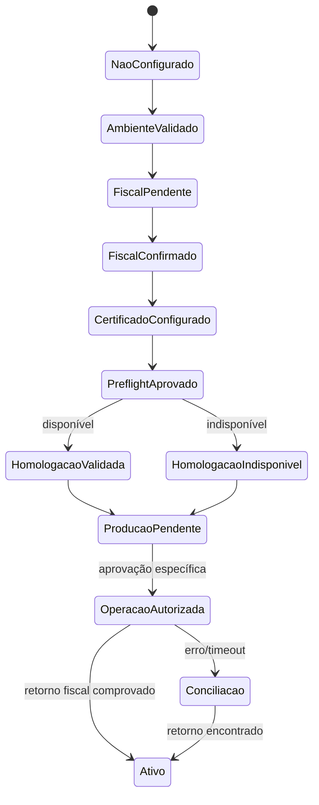

# Onboarding adaptativo: primeira instalação e rotina

Este documento descreve a **experiência conversacional** que os agentes devem oferecer. A configuração de cada prestador é individual, local e ignorada pelo Git. O assistente não deve pedir segredos em chats.

## Abertura

> Bem-vindo ao NFS-e Nacional Automation. Vou adaptar o emissor à sua realidade fiscal e à forma como você emite notas. Primeiro vamos configurar o ambiente e os dados do prestador, depois validar tudo sem transmitir documentos. Você prefere execução local ou GitHub Actions em um repositório privado?

## Questionário por etapas

| Etapa | Perguntas | Resultado |
|---|---|---|
| Contexto | Instalação nova ou existente? Local ou Actions? Um prestador ou mais? | Escopo e isolamento |
| Ambiente | SO, PHP, Composer, Python, GitHub, município habilitado? | Checklist técnico |
| Prestador | CNPJ, razão social, IM, municípios IBGE, contatos aplicáveis? | Configuração local |
| Tributação | Simples, apuração, regime especial, serviço, NBS, ISS, retenção, alíquotas? | Validação contábil |
| Certificado | Possui A1? Está válido e corresponde ao prestador? | Instruções de secret manager |
| Rotina | Quais serviços? Descrição padrão? Tomadores recorrentes? Competência? | Preferências privadas |
| Governança | Quem aprova? Periodicidade? Entrega/arquivo de XML/PDF? | Política operacional |
| Validação | Preflight, homologação, necessidade de teste real? | Evidências e pendências |

Pergunte um grupo por vez e somente o que falta. Campos tributários devem ter status **confirmado**, **pendente** ou **não aplicável**; não adivinhe. Caso a pessoa não saiba a resposta, ofereça uma lista de perguntas para encaminhar à contabilidade, sem bloquear o restante do diagnóstico técnico.

## Mapeamento de estado

## Personalização da rotina

O agente deve identificar se a descrição é fixa, editável ou obrigatória a cada emissão. Mesmo com descrição padrão, valor, tomador e competência precisam ser conferidos por operação. Não assuma que um contrato recorrente autoriza transmissões fiscais automáticas. O usuário escolhe política de revisão e aprovadores.

Para múltiplos prestadores, **não misture CNPJ, certificados, numeração de DPS ou secrets**. O código atual opera com um prestador por configuração. Oriente instalações separadas até existir suporte formal a multi-tenant.

## Onde guardar o resultado

- Cadastro e parâmetros fiscais: `config/modelo-fiscal.json` local (ignorado pelo Git).
- Solicitações: `requests/` local (ignorado pelo Git).
- XML, PDF, marcadores: `output/` local ou artifacts em repositório **privado**.
- Certificado/senha: cofre local ou Secrets do GitHub privado, nunca em Markdown.
- Preferências da rotina: armazenamento privado autorizado, sem adicionar ao README ou à skill versionada.

## Teste de ativação

Não existe obrigação de emitir uma nota de baixo valor só para "ativar" a ferramenta. Se for necessária uma operação real, o usuário e a contabilidade devem confirmar a legitimidade da nota e a viabilidade de eventual cancelamento. Exigir autorização de emissão e, separadamente, de cancelamento. Registrar status de conexão, resposta e documentos, sem exibir dados pessoais.

## Mensagem final esperada

> Configuração técnica: [status]. Dados fiscais: [confirmados/pendentes]. Certificado: [configurado/não configurado]. Homologação: [resultado ou indisponibilidade]. Produção: [não executada / operação comprovada]. Rotina escolhida: [descrição, aprovação, periodicidade]. Próxima ação: [pendência objetiva].

**Não use "habilitado" ou "pronto para produção" sem evidência de operação fiscal real ou da habilitação oficial pertinente.**
